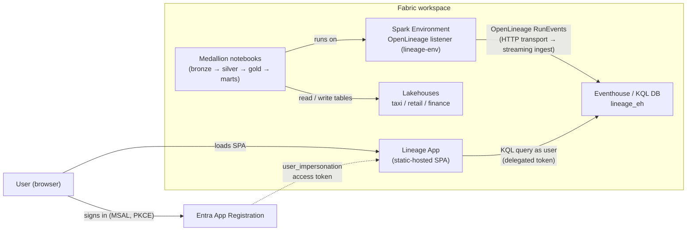

# Fabric Data Lineage App

An end-to-end **column-level data-lineage** solution for Microsoft Fabric.

Spark notebooks running in a Fabric workspace emit **OpenLineage** events, those
events are ingested into a Fabric **Eventhouse** (KQL database), and a Fabric
**App** (built with the Rayfin SDK) reads them through KQL functions to render an
interactive lineage graph, run history, and dataset/column statistics.

What's in this repo:

| Path | Contents |
| --- | --- |
| [app/](app) | The Fabric App (Rayfin static hosting) — read-only React SPA over the Eventhouse |
| [scripts/](scripts) | One-command **deploy** / **teardown** PowerShell scripts that provision the whole demo into a dedicated workspace (the ingestion token is kept fresh by a scheduled Fabric notebook) |
| [eventhouse/lineage_eh_schema.kql](eventhouse/lineage_eh_schema.kql) | Full KQL setup: tables, ingestion mapping, policies, functions, materialized views |
| [notebooks/](notebooks) | Bootstrap, medallion (taxi / retail / finance) and cleanup notebooks — each Spark job emits OpenLineage |
| [docs/openlineage-sample.json](docs/openlineage-sample.json) | A representative OpenLineage RunEvent emitted by Spark |

---

## 1. Solution architecture



| Component | What it is |
| --- | --- |
| Fabric workspace | Hosts the notebooks, Environment, Lakehouses, Eventhouse and the app — everything `deploy.ps1` provisions |
| Spark Environment | `lineage-env` — carries the OpenLineage Spark listener config; set as the workspace default Spark environment |
| Eventhouse | KQL database (`lineage_eh`) storing OpenLineage events |
| Lineage App | Rayfin **static-hosted** React SPA — frontend only, no server-side backend; the browser queries the Eventhouse directly |
| App Registration | Entra app used for sign-in + Eventhouse tokens |

> The Rayfin item only provides **static hosting** (and Fabric auth) for the SPA —
> no `data`, `storage`, or `functions` services are enabled. There is no
> server-side backend: the browser signs in and queries the Eventhouse directly.

---

## 2. Setup

The whole demo is provisioned by one PowerShell script.
[scripts/deploy.ps1](scripts/deploy.ps1) creates a brand-new workspace with
everything in it, and [scripts/teardown.ps1](scripts/teardown.ps1) removes it
again. Both use the Azure CLI (`az`) signed-in user for all Fabric calls.

**Prerequisites**

- [Azure CLI](https://learn.microsoft.com/cli/azure/) — run `az login` first.
- PowerShell 7+ (`pwsh`, cross-platform) or Windows PowerShell 5.1.
- A Fabric **capacity** (you pass its **name**) with the **Eventhouse** and
  **Fabric Apps (Preview)** workloads enabled.
- Rights to create Entra app registrations (and ideally to grant admin consent)
  — used by the default app-registration step.
- Node.js + the repo's `app/` dependencies — used by the default app deploy
  (disable both with `-CreateAppRegistration:$false -DeployApp:$false`).

**Provision**

```powershell
# from the repo root
az login
./scripts/deploy.ps1 -WorkspaceName lineage-test -CapacityName <your-capacity-name>
```

This will, in order: create the workspace (+ workspace identity) → create the
`_lineage` and `demo-data` folders → create the Eventhouse and deploy the KQL
schema → create and publish the `lineage-env` Spark Environment with the
OpenLineage transport, and set it as the workspace **default** Spark environment
→ create the `taxi_lh` / `retail_lh` / `finance_lh` lakehouses → upload the
medallion + cleanup notebooks → run them to generate synthetic data and lineage
→ create the Entra app registration → deploy the Rayfin app into the workspace.
All created ids are written to `scripts/.deploy-state.json`.

Items are organised into folders to keep the workspace tidy:

| Folder | Contents |
| --- | --- |
| `_lineage` | Eventhouse (+ KQL DB), `lineage-env` Environment, the two lineage notebooks |
| `demo-data` | The three sample lakehouses + the four medallion notebooks |
| _(root)_ | The Rayfin app (`lineage-app`, static hosting) |

The app registration and app deploy run **by default**. By default the deploy
**builds and hosts the source app** in `app/src` (its config is baked via
`app/rayfin/.env`, and the deployed hosting URL is added to the app
registration's SPA redirect URIs automatically). A prebuilt production bundle
may also be kept locally in `app/prebuilt/` as a backup (gitignored, not part of
the repo); pass `-UsePrebuiltApp:$true` to re-host that bundle instead of
building from source. Its runtime config is injected client-side into
`localStorage['lineage.config.v1']`.

To re-host the prebuilt bundle into an already-deployed workspace without
re-provisioning, run `./scripts/deploy-app.ps1` (requires the local
`app/prebuilt/` backup).

Useful switches:

| Switch | Effect |
| --- | --- |
| `-RunNotebooks:$false` | Upload the notebooks but don't execute them |
| `-CreateAppRegistration:$false` | Skip creating the Entra app registration |
| `-DeployApp:$false` | Skip deploying the Rayfin app |
| `-UsePrebuiltApp:$true` | Re-host the local prebuilt bundle (`app/prebuilt/`) instead of building from source |
| `-DeployedAppUrl <url>` | Add an extra SPA redirect URI to the app registration |
| `-EventhouseName <name>` | Override the Eventhouse/DB name (default `lineage_eh`) |

> If you hit *"running scripts is disabled on this system"*, launch with
> `pwsh -ExecutionPolicy Bypass -File ./scripts/deploy.ps1 ...` (or run
> `Set-ExecutionPolicy -Scope Process Bypass`).

**Decommission**

```powershell
./scripts/teardown.ps1            # reads scripts/.deploy-state.json
# or target by name (no state file needed):
./scripts/teardown.ps1 -WorkspaceName lineage-test -Force
# or target explicitly:
./scripts/teardown.ps1 -WorkspaceId <guid> -AppRegistrationClientId <appId> -Force
```

Teardown deletes the workspace (removing **all** items inside it, including the
app) and, unless you pass `-KeepAppRegistration`, the Entra app registration. It
also tidies the local generated artifacts (`app/.env.local`, `app/rayfin/.env`,
`app/rayfin/.deployments.json`) and resets `app/rayfin/rayfin.yml`'s redirect
URIs back to `localhost`.

> **Token note:** the OpenLineage transport authenticates with a Kusto access
> token captured at deploy time and baked into the Environment. That token
> expires (typically within an hour), so for anything longer than a quick test
> run, keep it fresh with the refresh notebook below.

**Keep ingestion alive (token refresh)**

Refreshing the token is a **Fabric-native notebook**,
[notebooks/lineage/01_refresh_openlineage_token.ipynb](notebooks/lineage/01_refresh_openlineage_token.ipynb),
so it runs in the cloud on a Fabric schedule — no laptop and no local `az`
session required. It resolves its own workspace, finds the `lineage-env`
Environment, gets a fresh Kusto token for its run identity, patches only
`spark.openlineage.transport.auth.apiKey`, and re-publishes.

`deploy.ps1` uploads it and creates an **hourly Fabric schedule** automatically
(tune with `-RefreshIntervalMinutes`, or `-RefreshIntervalMinutes 0` to skip).
You can also schedule or run it by hand from the Fabric notebook UI
(**Run -> Schedule**). It runs under your user identity, which already has
ingestor rights on the Eventhouse and contributor on the workspace.

---

## 3. How it works

The sections below describe what the deploy script configures and how the pieces
fit together — the Spark Environment, the Eventhouse schema, and the notebooks.

### 3.1 Spark Environment — enable OpenLineage

The deploy creates a Fabric **Environment** (`lineage-env`) and sets it as the
workspace default Spark environment, so notebooks and Spark jobs pick it up
automatically. The OpenLineage Spark listener is configured through Spark
properties applied to the Environment via the Fabric REST API; these are the
**exact** properties it sets:

| Property | Value |
| --- | --- |
| `spark.extraListeners` | `io.openlineage.spark.agent.OpenLineageSparkListener` |
| `spark.openlineage.namespace` | `fabric-lineage-demo` |
| `spark.openlineage.transport.type` | `http` |
| `spark.openlineage.transport.url` | `https://<cluster>.kusto.fabric.microsoft.com` *(the Eventhouse **query URI**)* |
| `spark.openlineage.transport.endpoint` | `/v1/rest/ingest/lineage_eh/OpenLineageRaw` |
| `spark.openlineage.transport.urlParams.streamFormat` | `SINGLEJSON` |
| `spark.openlineage.transport.urlParams.mappingName` | `OpenLineageRaw_mapping` |
| `spark.openlineage.transport.auth.type` | `api_key` |
| `spark.openlineage.transport.auth.apiKey` | *(a Kusto access token)* |

> **Ingestion path:** there is **no Eventstream**. The OpenLineage HTTP transport
> posts each RunEvent **directly** to the Eventhouse **streaming ingestion**
> endpoint (`<queryUri>/v1/rest/ingest/lineage_eh/OpenLineageRaw`) using the JSON
> mapping `OpenLineageRaw_mapping`. Streaming ingestion is enabled on the table.

The listener emits an OpenLineage **RunEvent** (`START`, then
`COMPLETE`/`FAIL`/`ABORT`) for every Spark SQL job, including `inputs`,
`outputs`, a `schema` facet, and a **`columnLineage`** facet. A representative
event is checked in at [docs/openlineage-sample.json](docs/openlineage-sample.json).

### 3.2 Eventhouse — ingest and shape the events

The Eventhouse holds a single raw table (`OpenLineageRaw`, one `dynamic` `event`
column per RunEvent) plus a set of **KQL functions** and **materialized views**
that normalise the events on demand. The app never reads the raw table — it reads
four functions: `lin_runs()`, `lin_datasets()`, `lin_table_edges_active()` and
`lin_column_edges_active()`.

The complete script is checked in at
[eventhouse/lineage_eh_schema.kql](eventhouse/lineage_eh_schema.kql) — it is what
the [00_setup_lineage](notebooks/lineage/00_setup_lineage.py) notebook deploys via
`.execute database script`. Run it in a KQL queryset / setup notebook against
`lineage_eh` (shown in full below):

<details>
<summary><strong>Full KQL setup script</strong> (tables, mapping, policies, functions, materialized views)</summary>

```kusto
// =============================================================================
// OpenLineage → Eventhouse schema
// Raw events land in OpenLineageRaw via the Spark OpenLineage HTTP transport
// (direct streaming ingestion). Functions/MVs parse runs / datasets /
// table edges / column edges.
// =============================================================================

.create-merge table OpenLineageRaw (
    event: dynamic,
    ingested_at: datetime
)

.alter table OpenLineageRaw policy retention "{'SoftDeletePeriod':'30.00:00:00','Recoverability':'Disabled'}"

.alter table OpenLineageRaw policy streamingingestion enable

.create-or-alter table OpenLineageRaw ingestion json mapping 'OpenLineageRaw_mapping'
'['
'  {"column":"event","Properties":{"path":"$"}}'
']'

// --- Parsing functions ---

.create-or-alter function with (folder='lineage', docstring='OL run state transitions')
lin_run_events() {
    OpenLineageRaw
    | extend
        event_type = tostring(event.eventType),
        event_time = todatetime(event.eventTime),
        run_id = tostring(event.run.runId),
        job_namespace = tostring(event.job.namespace),
        job_name = tostring(event.job.name),
        producer = tostring(event.producer)
    | where isnotempty(run_id)
    | project ingested_at, event_time, event_type, run_id, job_namespace, job_name, producer, event
}

.create-or-alter function with (folder='lineage', docstring='Run summary, one row per runId')
lin_runs() {
    lin_run_events()
    | summarize
        start_time = minif(event_time, event_type == 'START'),
        end_time   = maxif(event_time, event_type in ('COMPLETE','FAIL','ABORT')),
        statuses = make_set(event_type),
        job_namespace = take_any(job_namespace),
        job_name = take_any(job_name),
        producer = take_any(producer)
        by run_id
    | extend status = case(
        set_has_element(statuses, 'COMPLETE'), 'COMPLETE',
        set_has_element(statuses, 'FAIL'),     'FAIL',
        set_has_element(statuses, 'ABORT'),    'ABORT',
        'RUNNING')
    | project run_id, job_namespace, job_name, start_time, end_time, status, producer
}

.create-or-alter function with (folder='lineage', docstring='Dataset references from inputs/outputs')
lin_dataset_refs() {
    OpenLineageRaw
    | extend run_id = tostring(event.run.runId),
             event_time = todatetime(event.eventTime),
             event_type = tostring(event.eventType)
    | mv-expand io_kind = pack_array('input','output') to typeof(string)
    | extend nodes = iff(io_kind == 'input', event.inputs, event.outputs)
    | mv-expand node = nodes
    | where isnotnull(node)
    | extend
        ds_namespace = tostring(node.namespace),
        ds_name      = tostring(node.name),
        facets       = node.facets
    | project event_time, event_type, run_id, io_kind, ds_namespace, ds_name, facets, raw_node = node
}

.create-or-alter function with (folder='lineage', docstring='Latest known schema per dataset')
lin_datasets() {
    lin_dataset_refs()
    | where isnotnull(facets.schema)
    | summarize arg_max(event_time, *) by ds_namespace, ds_name
    | mv-expand field = facets.schema.fields
    | project ds_namespace, ds_name, last_seen = event_time,
              column_name = tostring(field.name),
              column_type = tostring(field.type),
              column_description = tostring(field.description)
}

.create-or-alter function with (folder='lineage', docstring='Table-level lineage edges')
lin_table_edges() {
    OpenLineageRaw
    | where tostring(event.eventType) == 'COMPLETE'
    | extend run_id = tostring(event.run.runId),
             event_time = todatetime(event.eventTime),
             job_name = tostring(event.job.name),
             inputs = event.inputs,
             outputs = event.outputs
    | mv-expand inp = inputs
    | mv-expand outp = outputs
    | where isnotnull(inp) and isnotnull(outp)
    | project event_time, run_id, job_name,
              src_namespace = tostring(inp.namespace),
              src_name      = tostring(inp.name),
              dst_namespace = tostring(outp.namespace),
              dst_name      = tostring(outp.name)
    | summarize arg_max(event_time, *) by run_id, src_namespace, src_name, dst_namespace, dst_name
}

.create-or-alter function with (folder='lineage', docstring='Column-level lineage edges')
lin_column_edges() {
    OpenLineageRaw
    | where tostring(event.eventType) == 'COMPLETE'
    | extend run_id = tostring(event.run.runId),
             event_time = todatetime(event.eventTime),
             job_name = tostring(event.job.name),
             outputs = event.outputs
    | mv-expand outp = outputs
    | extend
        dst_namespace = tostring(outp.namespace),
        dst_name      = tostring(outp.name),
        col_lineage   = outp.facets.columnLineage.fields
    | where isnotnull(col_lineage)
    | mv-expand kv = bag_keys(col_lineage) to typeof(string)
    | extend
        dst_column = kv,
        field_def  = col_lineage[kv]
    | mv-expand input_field = field_def.inputFields
    | project event_time, run_id, job_name, dst_namespace, dst_name, dst_column,
              src_namespace = tostring(input_field.namespace),
              src_name      = tostring(input_field.name),
              src_column    = tostring(input_field.field),
              transformation = tostring(field_def.transformationType),
              transformation_subtype = tostring(field_def.transformationSubtype)
    | summarize arg_max(event_time, *) by run_id, dst_namespace, dst_name, dst_column,
                                          src_namespace, src_name, src_column
}

// --- Materialized views (pre-computed, backfilled on creation) ---

.create-or-alter materialized-view with (backfill=true, folder='lineage', docstring='One row per run')
lin_runs_mv on table OpenLineageRaw {
    OpenLineageRaw
    | extend
        run_id = tostring(event.run.runId),
        event_type = tostring(event.eventType),
        event_time = todatetime(event.eventTime),
        job_namespace = tostring(event.job.namespace),
        job_name = tostring(event.job.name),
        producer = tostring(event.producer)
    | where isnotempty(run_id)
    | summarize
        start_time    = minif(event_time, event_type == 'START'),
        end_time      = maxif(event_time, event_type in ('COMPLETE','FAIL','ABORT')),
        statuses      = make_set(event_type),
        job_namespace = take_any(job_namespace),
        job_name      = take_any(job_name),
        producer      = take_any(producer)
        by run_id
}

.create-or-alter materialized-view with (backfill=true, folder='lineage', docstring='Latest schema per dataset')
lin_datasets_mv on table OpenLineageRaw {
    OpenLineageRaw
    | extend event_time = todatetime(event.eventTime)
    | mv-expand io_kind = pack_array('input','output') to typeof(string)
    | extend nodes = iff(io_kind == 'input', event.inputs, event.outputs)
    | mv-expand node = nodes
    | where isnotnull(node) and isnotnull(node.facets.schema)
    | extend
        ds_namespace = tostring(node.namespace),
        ds_name      = tostring(node.name),
        schema_facet = node.facets.schema
    | summarize arg_max(event_time, schema_facet) by ds_namespace, ds_name
}

.create-or-alter materialized-view with (backfill=true, folder='lineage', docstring='Table-level lineage edges')
lin_table_edges_mv on table OpenLineageRaw {
    OpenLineageRaw
    | where tostring(event.eventType) == 'COMPLETE'
    | extend run_id     = tostring(event.run.runId),
             event_time = todatetime(event.eventTime),
             job_name   = tostring(event.job.name)
    | mv-expand inp = event.inputs
    | mv-expand outp = event.outputs
    | where isnotnull(inp) and isnotnull(outp)
    | project event_time, run_id, job_name,
              src_namespace = tostring(inp.namespace),
              src_name      = tostring(inp.name),
              dst_namespace = tostring(outp.namespace),
              dst_name      = tostring(outp.name)
    | summarize arg_max(event_time, *) by run_id, src_namespace, src_name, dst_namespace, dst_name
}

.create-or-alter materialized-view with (backfill=true, folder='lineage', docstring='Column-level lineage edges')
lin_column_edges_mv on table OpenLineageRaw {
    OpenLineageRaw
    | where tostring(event.eventType) == 'COMPLETE'
    | extend run_id     = tostring(event.run.runId),
             event_time = todatetime(event.eventTime),
             job_name   = tostring(event.job.name)
    | mv-expand outp = event.outputs
    | extend
        dst_namespace = tostring(outp.namespace),
        dst_name      = tostring(outp.name),
        col_lineage   = outp.facets.columnLineage.fields
    | where isnotnull(col_lineage)
    | mv-expand kv = bag_keys(col_lineage) to typeof(string)
    | extend
        dst_column = kv,
        field_def  = col_lineage[kv]
    | mv-expand input_field = field_def.inputFields
    | project event_time, run_id, job_name, dst_namespace, dst_name, dst_column,
              src_namespace = tostring(input_field.namespace),
              src_name      = tostring(input_field.name),
              src_column    = tostring(input_field.field),
              transformation         = tostring(field_def.transformationType),
              transformation_subtype = tostring(field_def.transformationSubtype)
    | summarize arg_max(event_time, *) by run_id, dst_namespace, dst_name, dst_column,
                                          src_namespace, src_name, src_column
}

// =============================================================================
// Deleted-dataset tombstones — maintained by the 00_refresh_active_tables
// notebook. It enumerates every Lakehouse in the workspace, diffs the live
// tables against URIs seen in OL events, and writes one tombstone row per
// *missing* (deleted) URI tagged with a snapshot_id. The *_active views below
// hide any edge that touches a tombstoned URI. New tables are visible instantly;
// only drops wait for the next refresh.
// =============================================================================

.create-merge table lin_active_datasets (
    snapshot_id: string, full_uri: string, snapshot_at: datetime
)
.alter table lin_active_datasets policy retention "{'SoftDeletePeriod':'7.00:00:00','Recoverability':'Disabled'}"
.alter table lin_active_datasets policy streamingingestion enable
.create-or-alter table lin_active_datasets ingestion json mapping 'lin_active_datasets_mapping'
'['
'  {"column":"snapshot_id","Properties":{"path":"$.snapshot_id"}},'
'  {"column":"full_uri",   "Properties":{"path":"$.full_uri"}},'
'  {"column":"snapshot_at","Properties":{"path":"$.snapshot_at"}}'
']'

.create-merge table lin_deleted_datasets (
    snapshot_id: string, full_uri: string, snapshot_at: datetime
)
.alter table lin_deleted_datasets policy retention "{'SoftDeletePeriod':'30.00:00:00','Recoverability':'Disabled'}"
.alter table lin_deleted_datasets policy streamingingestion enable
.create-or-alter table lin_deleted_datasets ingestion json mapping 'lin_deleted_datasets_mapping'
'['
'  {"column":"snapshot_id","Properties":{"path":"$.snapshot_id"}},'
'  {"column":"full_uri",   "Properties":{"path":"$.full_uri"}},'
'  {"column":"snapshot_at","Properties":{"path":"$.snapshot_at"}}'
']'

.create-or-alter function with (folder='lineage', docstring='URIs of tables that no longer exist (latest tombstone snapshot)')
lin_deleted_uris() {
    let latest_id = toscalar(lin_deleted_datasets | summarize arg_max(snapshot_at, snapshot_id) | project snapshot_id);
    lin_deleted_datasets
    | where snapshot_id == latest_id
    | project full_uri = tolower(full_uri)
    | distinct full_uri
}

.create-or-alter function with (folder='lineage', docstring='Legacy: URIs from the latest allowlist snapshot. Prefer lin_deleted_uris().')
lin_active_uris() {
    let latest_id = toscalar(lin_active_datasets | summarize arg_max(snapshot_at, snapshot_id) | project snapshot_id);
    lin_active_datasets
    | where snapshot_id == latest_id
    | project full_uri = tolower(full_uri)
    | distinct full_uri
}

.create-or-alter function with (folder='lineage', docstring='Table edges with edges to deleted tables filtered out')
lin_table_edges_active() {
    let deleted = lin_deleted_uris();
    lin_table_edges_mv
    | extend src_uri = tolower(strcat(src_namespace, src_name)),
             dst_uri = tolower(strcat(dst_namespace, dst_name))
    | where src_uri !in (deleted) and dst_uri !in (deleted)
    | project-away src_uri, dst_uri
}

.create-or-alter function with (folder='lineage', docstring='Column edges with edges to deleted tables filtered out')
lin_column_edges_active() {
    let deleted = lin_deleted_uris();
    lin_column_edges_mv
    | extend src_uri = tolower(strcat(src_namespace, src_name)),
             dst_uri = tolower(strcat(dst_namespace, dst_name))
    | where src_uri !in (deleted) and dst_uri !in (deleted)
    | project-away src_uri, dst_uri
}
```

</details>

The OpenLineage transport ingests using a **user-identity Kusto token** captured
at deploy time. The user already has ingestor rights as the Eventhouse owner, so
no extra grant is needed; the scheduled refresh notebook (below) keeps the token
fresh under the same user identity.

> **App ↔ Eventhouse contract:** `lin_runs`, `lin_datasets`,
> `lin_table_edges_active` and `lin_column_edges_active` are the **only**
> functions the app calls. As long as they return the columns shown above, the
> UI works regardless of how the raw events were produced.

### 3.3 The medallion notebooks

The medallion notebooks populate the Eventhouse — every Spark job they run emits
OpenLineage events. The repo ships:

| Notebook | Folder | Role |
| --- | --- | --- |
| `00_setup_lineage.py` | `notebooks/lineage/` | Deploys the KQL schema and configures/publishes the Spark Environment |
| `00_refresh_active_tables` | `notebooks/lineage/` | Refreshes the deleted-dataset tombstones (`lin_deleted_datasets`) so dropped tables disappear from the graph |
| `01_refresh_openlineage_token` | `notebooks/lineage/` | Re-publishes the `lineage-env` Environment with a fresh ingestion token; scheduled hourly in Fabric |
| `01_bronze_silver`, `02_gold`, `03_marts`, `04_cross_marts` | `notebooks/demo-lakehouse/` | Medallion pipeline across the `taxi_lh` / `retail_lh` / `finance_lh` Lakehouses — generate synthetic taxi/retail/finance data, and each Spark job emits OpenLineage events |

The notebooks are grouped into two folders: **`notebooks/lineage/`** (the things
the lineage solution itself needs) and **`notebooks/demo-lakehouse/`** (the demo
medallion jobs that produce sample data + lineage). `deploy.ps1` uploads and (by
default) runs them. The sample event in
[docs/openlineage-sample.json](docs/openlineage-sample.json) is a representative
RunEvent emitted by one of these jobs.

Until at least one job has run, the app shows the "No lineage yet" empty state.

### 3.4 Local app development

`deploy.ps1` deploys the app for you, but you can also run the source app
(`app/src`) locally. Use `npm run dev` (provisions a dev app instance and starts
Vite on `http://localhost:5173`). Copy [app/.env.example](app/.env.example) to
`app/.env.local` and fill in your workspace, Eventhouse, and Entra values.

---

## 4. The app

A single-page React app, served via Rayfin **static hosting**, with two tabs:

- **Lineage** — overview stat tiles (tables, columns, table/column edges, runs,
  succeeded/failed/running), a **table-level lineage graph**, a filter, and a
  **recent runs** table with status colours. Backed by the four KQL functions
  above via `LineageService` (`/v1/rest/query`).
- **Settings** — Eventhouse cluster URI, KQL database name, and identity values.
  Persisted to `localStorage` (`lineage.config.v1`), overriding build-time
  defaults so the app can be re-pointed without a rebuild.

---

## 5. Authentication

The SPA acquires per-resource tokens with **MSAL** and queries the Eventhouse
directly **as the signed-in user** — there is no service principal or shared
secret in the read path.

1. The SPA signs the user in with **MSAL** (authorization code + PKCE) against
   the App Registration.
2. To query lineage it requests a token with scope **`<clusterUri>/.default`** —
   i.e. the Eventhouse cluster's **`user_impersonation`** delegated permission.
3. It calls `POST <clusterUri>/v1/rest/query` with
   `Authorization: Bearer <user-token>` and body `{ db, csl }`. Queries run
   **as the signed-in user**, so each user needs at least **Viewer** rights on
   the `lineage_eh` database.

The first call triggers an interactive consent/redirect for the cluster scope;
after that, tokens are renewed silently.

> App login is **not** forced (`VITE_REQUIRE_APP_LOGIN=false`): the user is only
> prompted to sign in when a view first needs a token.

---

## 6. Repository layout

```
README.md                         This guide (setup + how it works)
LICENSE
app/                              Fabric App (Rayfin static hosting)
  rayfin/                         App definition (Fabric auth + static hosting)
    rayfin.yml                    auth + staticHosting
  src/                            SPA (config, theme, services, pages)
  prebuilt/                       Local-only prebuilt bundle backup (gitignored)
  .env.example                    Documented configuration variables
  README.md                       App-level dev/run guide
scripts/
  deploy.ps1                      Provision the whole demo into a dedicated workspace
  teardown.ps1                    Delete the workspace (and optional app registration)
  deploy-app.ps1                  Re-host the prebuilt app bundle into an existing workspace
  lib/fabric.ps1                  Shared helpers (Fabric REST + Kusto + notebook upload)
  lib/prebuilt-app.ps1            Helpers for staging the prebuilt app dist
eventhouse/
  lineage_eh_schema.kql           Full KQL setup (tables, mapping, policies, functions, MVs)
notebooks/
  lineage/                        Notebooks the lineage solution itself needs
    00_setup_lineage.py           Bootstrap notebook (deploy schema + configure Environment)
    00_refresh_active_tables.ipynb  Tombstone cleanup for deleted datasets
    01_refresh_openlineage_token.ipynb  Refresh the ingestion token (scheduled in Fabric)
  demo-lakehouse/                 Demo medallion jobs (produce sample data + lineage)
    01_bronze_silver.ipynb        Medallion: synthetic taxi bronze + silver
    02_gold.ipynb                 Medallion: taxi gold aggregates
    03_marts.ipynb                Medallion: zone dimension + enriched trips
    04_cross_marts.ipynb          Cross-lakehouse marts (taxi + retail + finance)
docs/
  openlineage-sample.json         Representative OpenLineage RunEvent (Spark)
```

---

## 7. Limitations

This is a **demo / proof-of-concept**, not a production-ready solution:

- **Not for production:** the Eventhouse ingestion token is exposed in the Spark
  Environment (`spark.openlineage.transport.auth.apiKey`). A scheduled notebook
  re-publishes it, but a static bearer token baked into cluster config is not an
  acceptable production secret-handling pattern.
- **Needs extensive testing**, especially around the table lifecycle. Renaming a
  lakehouse table breaks its lineage (it looks like a drop plus a brand-new
  table). The tombstone cleanup (`00_refresh_active_tables`) marks the old name
  as deleted — but for **Spark-generated** tables that is arguably wrong, since
  the next job run recreates the table under the same name; deletion tracking
  may be better disabled for those.
- **Spark / OpenLineage only.** Lineage is captured solely from Spark jobs that
  run with the OpenLineage listener. Anything created or changed another way —
  manually, via T-SQL, the Warehouse, plain Python, pipelines, etc. — is **not**
  represented in the graph.
